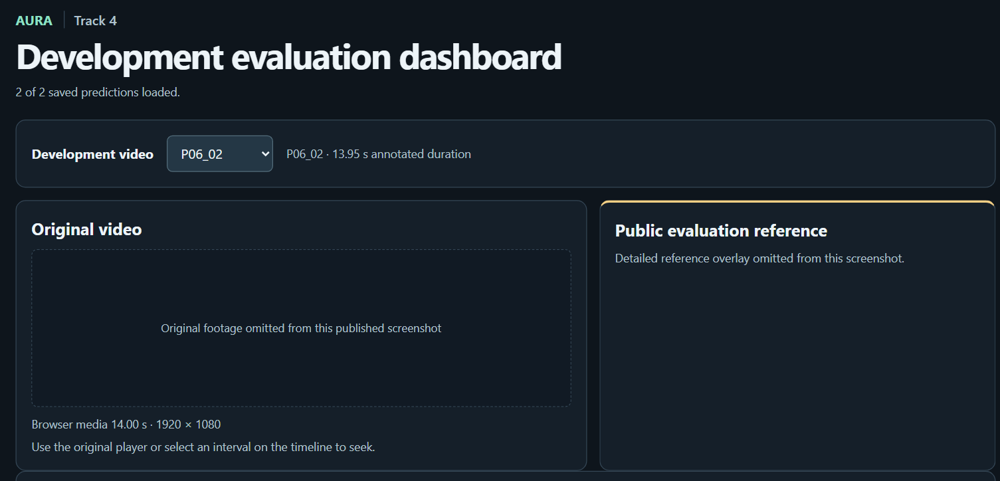
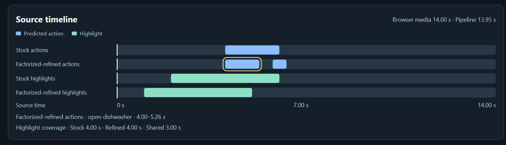
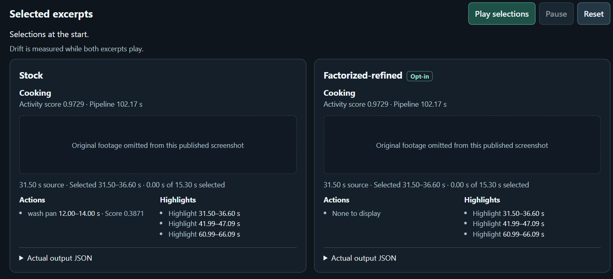
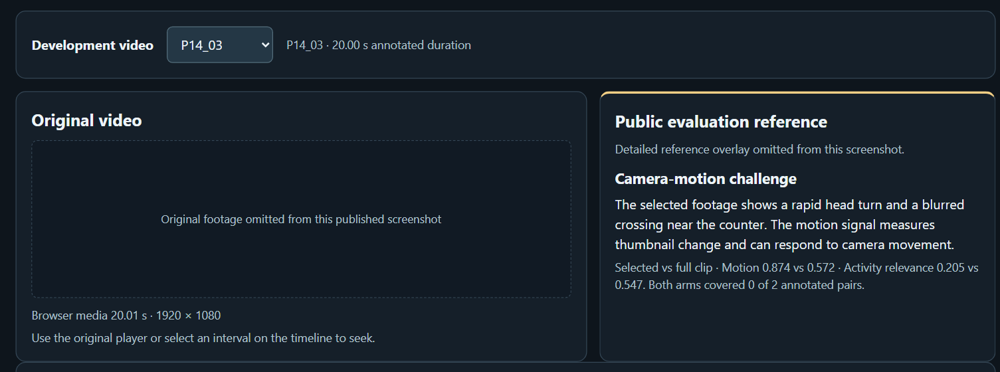
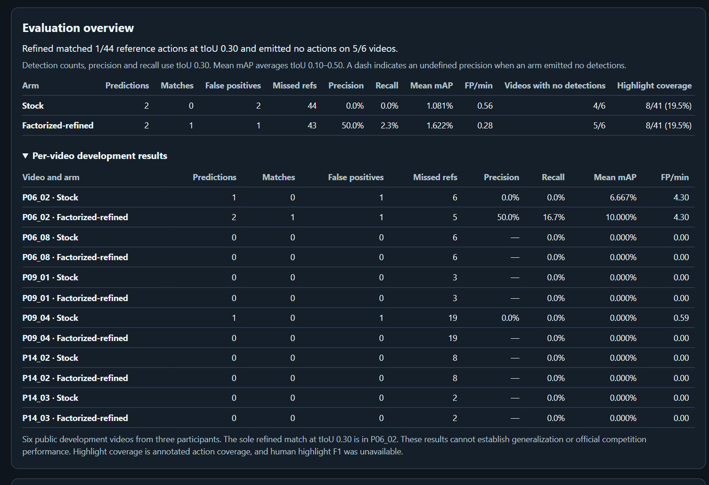
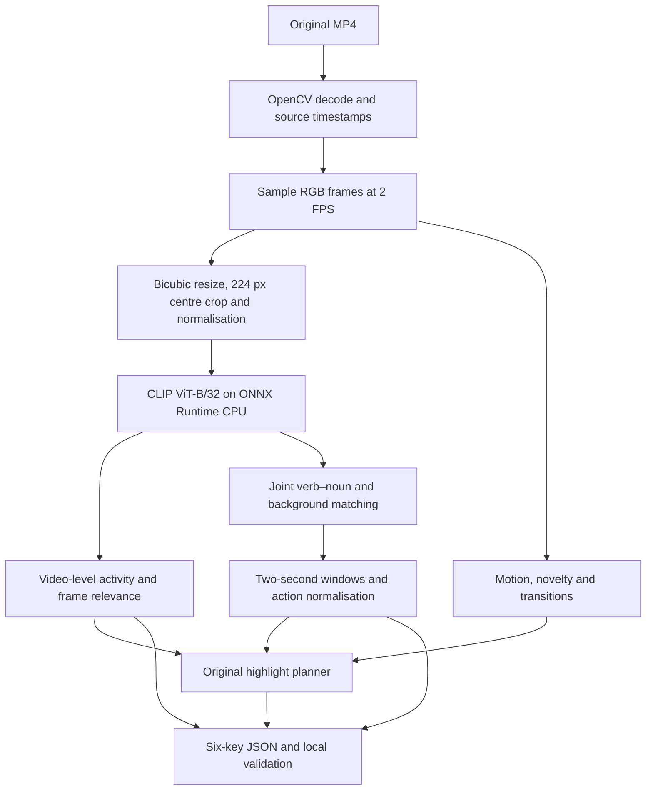

# AURA

**Action-Aware Understanding and Retrieval Assistant**

Samsung PRISM XR Hackathon 2026 · Track 4 · Action-Aware Video Summarization · Team `Three_Stars`

**Engineering release published. Competition submission pending.** The registered team identifier is pending written organiser confirmation. [Public repository](https://github.com/Ramkrishna4816/Aura_Track4) · [Engineering branch](https://github.com/Ramkrishna4816/Aura_Track4/tree/final-engineering-release) · [Frozen engineering tag](https://github.com/Ramkrishna4816/Aura_Track4/tree/aura-track4-engineering-v1) · [Submission status](docs/SUBMISSION_STATUS.md)

## What AURA does

Long first-person recordings are difficult to navigate because useful interactions are scattered throughout the footage. AURA processes an original MP4 and writes structured JSON in source-video seconds. The activity label supplies context, localised verb–noun predictions describe individual interactions, and highlight intervals point to footage worth reviewing. AURA can select highlights when the action detector abstains.

| Output | Contents |
|---|---|
| Activity | Predicted overall label and a prompt-relative score. |
| Actions | Start and end times, verb, noun and score for each accepted event. |
| Highlights | Start and end times for selected excerpts of the original video. |

## See the system

The interactive dashboard compares saved stock and opt-in factorized-refined results across six development videos. It has a shared source timeline, prediction tracks, highlight excerpts and per-clip evidence. Run it locally with the engineering handoff and the authorised EPIC-KITCHENS originals. [Local dashboard and demo instructions](demo/README.md)



<details>
<summary>Action timeline, model comparison, and evaluation</summary>









</details>

| Presentation material | Current status |
|---|---|
| Presentation | Team review required before publication. [Presentation status](presentation/) |
| Hosted demo | Pending an approved recording and evaluator access check. [Demo status](demo/README.md) |

## Production architecture



The frozen sampler caps the longest side at 320 px before CLIP preprocessing. The encoder resizes the short side to 224 px with bicubic interpolation, applies a 224 × 224 centre crop and normalises RGB channels. Activity classification aggregates similarity to activity text prompts across sampled frames. The action recogniser compares joint verb–noun prompts with background prompts in two-second windows, and the planner selects non-overlapping source intervals using visual change, activity relevance and overlapping action evidence. [Architecture and interfaces](docs/ARCHITECTURE.md) · [Model artifacts and data terms](docs/MODELS_AND_DATA.md)

Factorized-refined remains an opt-in development candidate. The stock launcher uses joint verb–noun matching and the original highlight planner. The experimental two-frame support rule remains outside production.

## Development evaluation

These measurements use six public EPIC-KITCHENS development clips from three participants. The clips represent one activity category and sit outside the competition manifest.

| Local development metric | Frozen stock | Factorized-refined, opt-in |
|---|---:|---:|
| Mean local action mAP across tIoU 0.10–0.50 | 1.081% | 1.622% |
| Matched reference actions at tIoU 0.30 | 0/44 | 1/44 |
| Recall at tIoU 0.30 | 0.00% | 2.27% |
| Precision at tIoU 0.30 | 0.00% | 50.00% |

Five of six clips had no refined action detections. One additional match on this small development set provides limited evidence about generalisation. Official competition performance remains unmeasured. [Evaluation method, clip-level results and caveats](docs/EVALUATION_REPORT.md)

## Engineering verification

| Verification | Recorded result |
|---|---|
| Full Python regression suite | 442 tests and 373 subtests passed. 19 skipped for platform or optional dependencies. |
| Dedicated local validator | 13 tests and 23 subtests passed. |
| Compilation and dependencies | 116 Python sources compiled, two JavaScript test files passed syntax checks, and `pip check` found no broken requirements. |
| Browser QA | Seven rescue-demo and five multi-video Edge scenarios passed with zero unexpected console errors. |
| Release integrity | 33 production files and three pinned model assets matched their expected hashes. |

The 19 skips cover POSIX launching (8), Linux RSS measurement (5), optional PyTorch (5) and missing FFmpeg tooling (1). These checks measure software behaviour and integrity. Model accuracy is reported separately above. The full evidence is retained with the engineering handoff. [Evidence and reproduction](docs/REPRODUCIBILITY.md)

## Reproduce locally

Use Python 3.12 on `PATH` from the repository root. This PowerShell setup installs the pinned dependencies and downloads three SHA-256-verified CLIP artifacts to `TEAM_ID/weights/`.

```powershell
python -m venv .venv
$python = '.\.venv\Scripts\python.exe'
& $python -m pip install -r TEAM_ID/requirements.txt
& $python -m pip check
& $python TEAM_ID/code/fetch_weights.py
```

### Open the six-video dashboard

Place the engineering handoff's benchmark, public reference subset and saved development comparisons in the paths in the [demo instructions](demo/README.md). Set `$mediaRoot` to the authorised EPIC-KITCHENS directory that contains the participant folders.

```powershell
$mediaRoot = Read-Host 'Path to the authorised EPIC-KITCHENS directory'
& $python -B examples/make_multi_video_dashboard.py --media-root $mediaRoot --serve --open
```

### Run one authorized original

The frozen launcher accepts exactly two positional arguments, an MP4 and an output JSON. Run it from Linux or WSL after the Bash setup in the reproduction guide. The Windows equivalent is `TEAM_ID/code/run_aura.py`. Competition runs require the case-sensitive registered team identifier, signed-off manifest scope, verified originals and the confirmed validation contract. [Platform setup, batch and validation commands](docs/REPRODUCIBILITY.md)

```bash
AURA_PROFILE=readme6 AURA_TEAM_ID="${AURA_TEAM_ID:?Set the confirmed identifier}" \
  AURA_SAMPLE_FPS=2 AURA_ACTION_WINDOW_SECONDS=2 AURA_BUDGET_RATIO=0.15 \
  AURA_MIN_HIGHLIGHT_SECONDS=1 AURA_HIGHLIGHT_POLICY=minimum \
  AURA_WEIGHTS_DIR="$PWD/TEAM_ID/weights" PYTHON="$PWD/.venv/bin/python" \
  ./TEAM_ID/run.sh "${INPUT_MP4:?Set the verified input path}" "${OUTPUT_JSON:?Set a fresh output path}"
```

## Repository map

```text
Aura_Track4/
├── assets/screenshots/      Verified dashboard captures
├── demo/                    Launch and recording information
├── presentation/            Approved deck status
├── docs/                    Architecture, evaluation and reproduction
├── TEAM_ID/
│   ├── code/                Frozen inference, taxonomy and manifest
│   ├── Dockerfile           CPU runtime image definition
│   ├── requirements.txt     Pinned inference dependencies
│   ├── run.sh               Two-argument production launcher
│   └── outputs/             Empty competition output directory
├── evaluation/              Evaluation command support
├── examples/                Dashboard, release and validation workflows
├── tests/                   Browser regression checks
├── licenses/                Third-party license notices
└── validate_outputs.py      Independent local prediction validator
```

The verified engineering source handoff includes the three model assets. The GitHub serving workflow retrieves them using the pinned fetcher. [Model revisions and checksums](docs/MODEL_WEIGHTS.json)

## Licensing and AI disclosure

The included third-party MIT notice covers OpenAI CLIP and its applicable model artifacts. Source video and reference data have separate terms. A project-wide distribution license is pending team confirmation. [CLIP license notice](licenses/OpenAI-CLIP-MIT.txt) · [Data and attribution](docs/MODELS_AND_DATA.md) · [AI-use disclosure](docs/AI_DISCLOSURE.md)

## Competition and team

The submission output directory contains **0 registered predictions**. The supplied manifest lists 187 originals. A 185-video scope requires written approval of both requested Scuba exclusions. The registered identifier, verified source coverage and official validation requirements remain unresolved. [Submission status](docs/SUBMISSION_STATUS.md)

AURA is the `Three_Stars` project for Samsung PRISM XR Hackathon 2026, Track 4. [Project repository](https://github.com/Ramkrishna4816/Aura_Track4)
