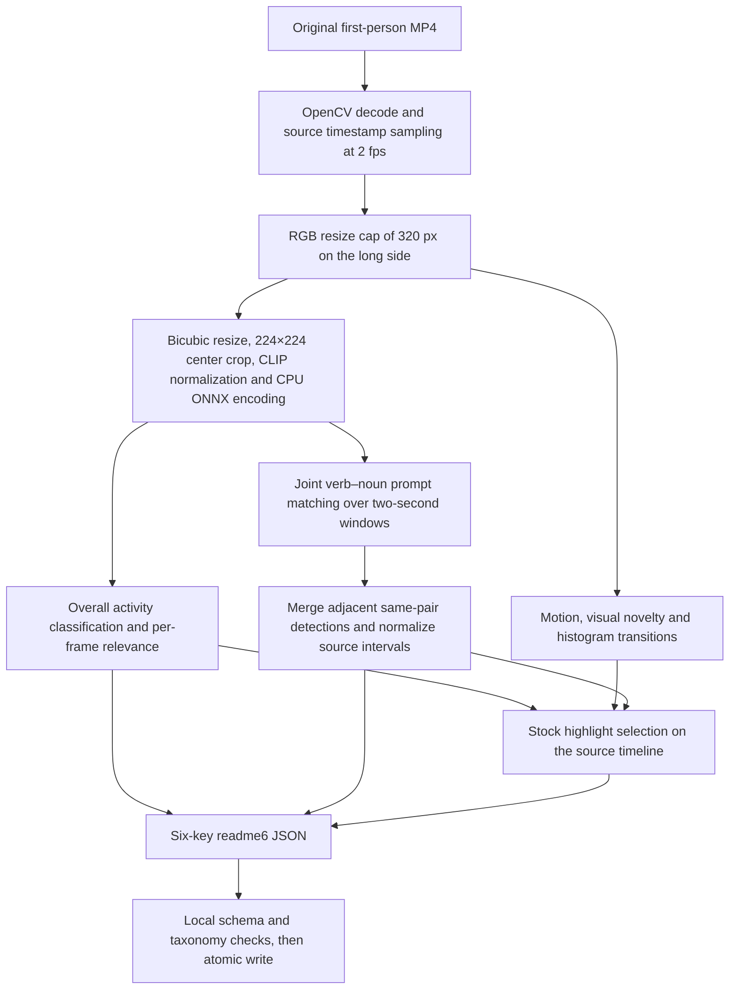
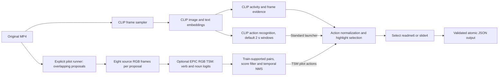
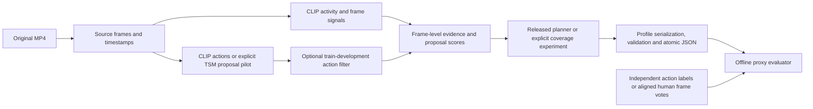
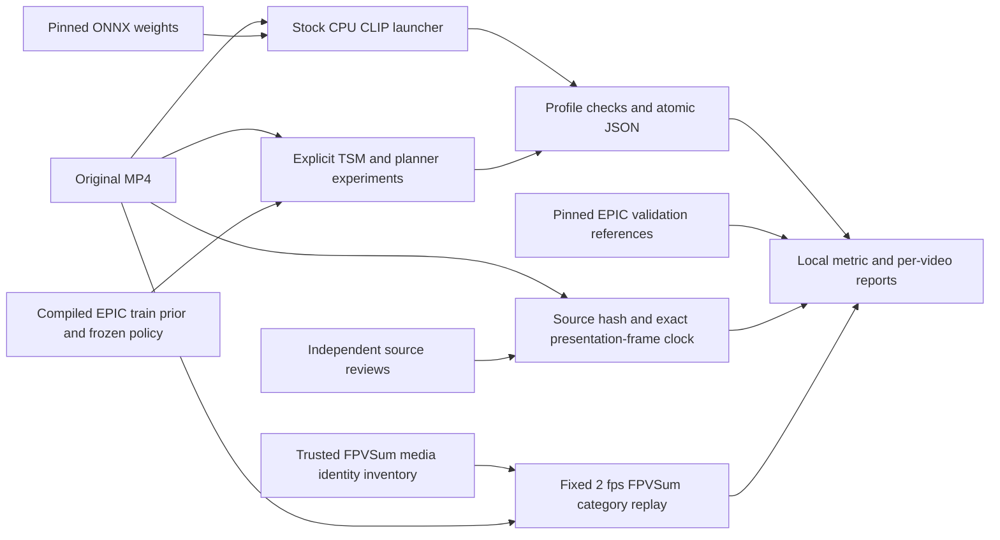
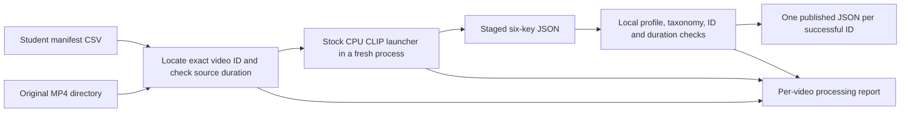

# Architecture

The diagram shows the frozen competition-oriented `readme6` path. Factorized-refined and the two-frame support rule are development comparisons. The stock launcher uses neither.

## Runtime and interfaces

`TEAM_ID/run.sh` finds its own directory, resolves the Python interpreter, and delegates to `code/run_aura.py`. The same Python script works as a direct entry point. Relative inputs and outputs resolve from the caller's working directory. The pipeline uses the same inference logic for every source video. The input stem supplies `video_id` only after the video is identified for output.

The production path uses local SHA-256-pinned ONNX weights and the same CLIP prompt comparisons for every source. The batch wrapper filters the manifest before launch and uses durations for input and output validation. The model receives source frames and no reference labels. Use the release guide's explicit stock settings when preparing release predictions. [Run commands and settings](SUBMISSION_RELEASE_GUIDE.md)

| Module | Responsibility |
|---|---|
| `main.py` | Parse configuration, orchestrate inference, selection, validation and writing, report exit status |
| `preprocessing.py` | Read duration and produce timestamped frames from the original video, at 2 fps by default |
| `clip_backend.py`, `clip_predictor.py` | Load verified ONNX encoders, compare prompt embeddings, and return activity, actions, and frame evidence |
| `labeling.py`, `action_recognition.py` | Separate interfaces for callers injecting a video labeler and action recognizer |
| `normalize.py` | Reject malformed actions, clip small boundary overshoots, round and sort accepted segments, record rejections |
| `importance_scoring.py` | Compute visual change and combine it with model activity and action evidence |
| `highlight_selection.py` | Rank candidates, enforce interval constraints, and report budget use |
| `models.py` | Store uniform internal `VideoContext`, `Label`, `ActionSegment`, `Highlight`, and `VideoPrediction` values |
| `taxonomy.py` | Read and check the bundled organizer class vocabulary |
| `serialization.py`, `profile_readme6.py`, `profile_slide4.py` | Translate internal predictions, check schemas, and serialize strict JSON |
| `io_utils.py` | Create target directories as needed and atomically replace a complete output |

CLIP converts RGB frames and text prompts to comparable vectors. Each candidate event uses a jointly authored verb–noun prompt, so both fields refer to one inferred event. The action module can abstain. An empty action list still allows video labelling and highlight selection from frame evidence. See [Models and data](MODELS_AND_DATA.md) for the model and thresholds.

## Importance and selection

Each candidate interval receives a duration-weighted average of frame scores. The default combination uses motion (0.30), visual novelty (0.25), histogram transitions (0.15), relevance to the predicted video label (0.20), and maximum overlapping predicted-action confidence (0.10). Programmatic callers can pass `importance_weights=ImportanceWeights(...)` to `run_pipeline`. RGB thumbnail differences and histogram statistics supply the visual signals. CLIP supplies the semantic similarity and action components. The combined value is a heuristic.

The selector ranks windows of about six seconds where the source length and budget permit. It works on the output timestamp grid of hundredths of a second, selects non-overlapping windows, and joins adjacent selected intervals. Durations and budgets are computed from source timestamps. Candidate scores favor evidence-rich intervals and tie-breaking is deterministic.

The normal budget is 15% of source duration. Under the default minimum-first policy, a source at least four seconds long can receive one four-second `readme6` highlight even when four seconds exceeds the budget. Set `AURA_HIGHLIGHT_POLICY=budget` to favor the target in this conflict. In this case a shorter `readme6` interval can produce a local validation warning. Shorter source videos can receive shorter intervals where representable. The minimum-first `readme6` policy can use one grid tick when a positive source interval fits and the original budget is smaller than a tick. The `slide4` example establishes no four-second minimum. The full workspace records organizer ambiguity and policy rationale in `docs/PROJECT_OVERVIEW.md`.

## Serialization, validation and errors

One profile serializes the shared prediction per run. `readme6` emits confidence but omits internal highlight importance. `slide4` emits importance but omits label and action confidence. Each profile declares where every dataclass field is emitted or why it is omitted. Local checks cover exact key sets, finite values, timestamp bounds and ordering, and taxonomy membership. Validation reports distinguish warnings from errors and identify the basis of each rule.

Only validated content reaches `io_utils`. The writer places the complete JSON in a temporary file in the destination directory, flushes it, and replaces the target atomically. A failed run leaves any existing target intact.

The organizer's official validation code is absent. The separate release validator checks the finished set against the manifest, team ID, and expected taxonomy. The model produces its visual activity prediction. A class that fails a dataset-specific release rule stops validation and needs review. Competition accuracy and official acceptance require separate evidence. [Six-key contract](SUBMISSION_RELEASE_GUIDE.md#output-contract)

[Setup and exit codes](../TEAM_ID/README.md)

The following sections document separate research paths. Their linked protocols and results are part of the full workspace.

## Optional TSM action pilot

The standard launcher keeps the same CLIP models and dependencies. The separate pilot runner selects one TSM proposal policy and sends its actions through the existing report, highlight, and serialization path. CLIP still supplies the activity label and sampled visual evidence. Action confidence can affect highlight ranking in the pilot. See `docs/TSM_PILOT_PROTOCOL.md` and `docs/TSM_MODEL.json` in the full workspace.

## Competition experiments and measurement

The annotation inputs are separate from the inference path. An inference replay can reuse measured CLIP frame evidence and scored model actions for the identical source. This holds the model signals fixed when comparing planners. A development-only policy can reject TSM proposals before the comparison is scored. The stock launcher retains the existing model, timeline and highlight behavior. The full workspace records the protocol in `docs/FINAL_OPTIMIZATION_PROTOCOL.md`.

## Final validation and data identity

The offline reviewer path replays the decoded source clock and the human votes before scoring. The FPVSum category replay verifies each approved original against an expected hash before decode. The scoring paths use references outside model classification, which uses video frames. The full workspace records the metric definitions in `docs/FINAL_VALIDATION_METRICS.md`. [Release guide](SUBMISSION_RELEASE_GUIDE.md)

## Student manifest batch

Manifest rows determine which inputs to open and which results to validate. The model receives the MP4 frames and the same settings as single-video inference. The outer runner measures time and peak RSS for each launcher process and checkpoints outcomes separately from prediction JSON. The full workspace retains the initial runner notes in `docs/DAY3_STUDENT_KIT.md`. [Batch command](SUBMISSION_RELEASE_GUIDE.md#generate-and-check-a-batch)
